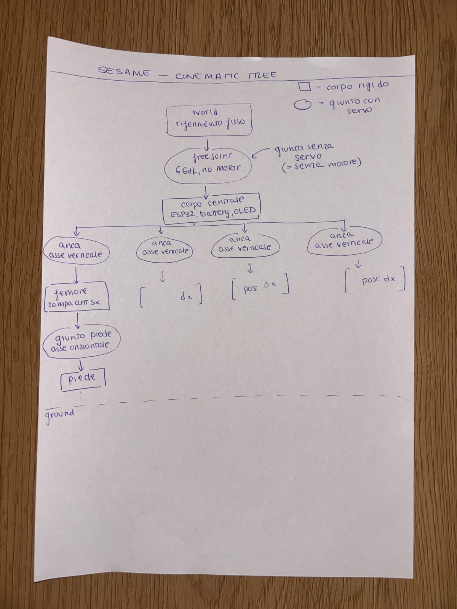
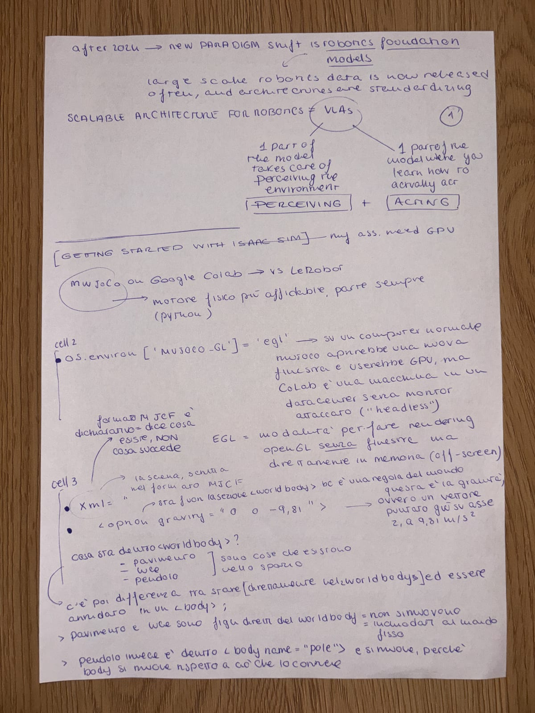
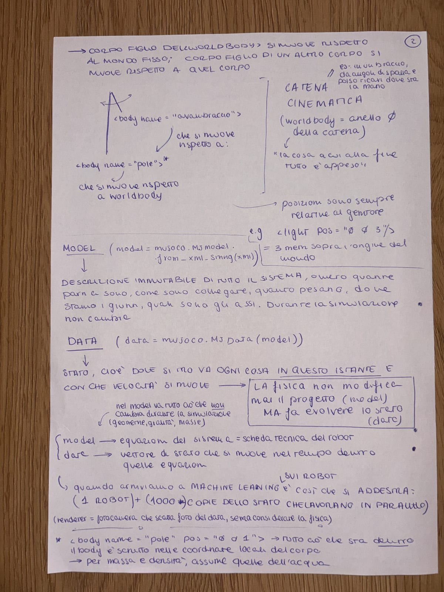
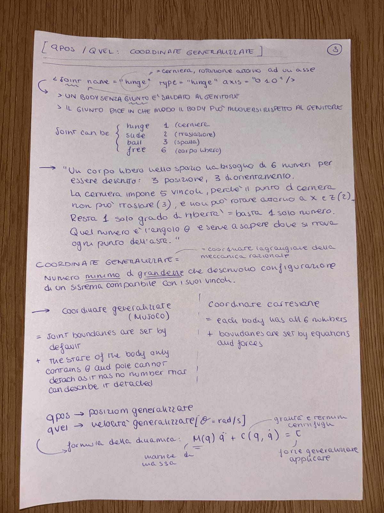
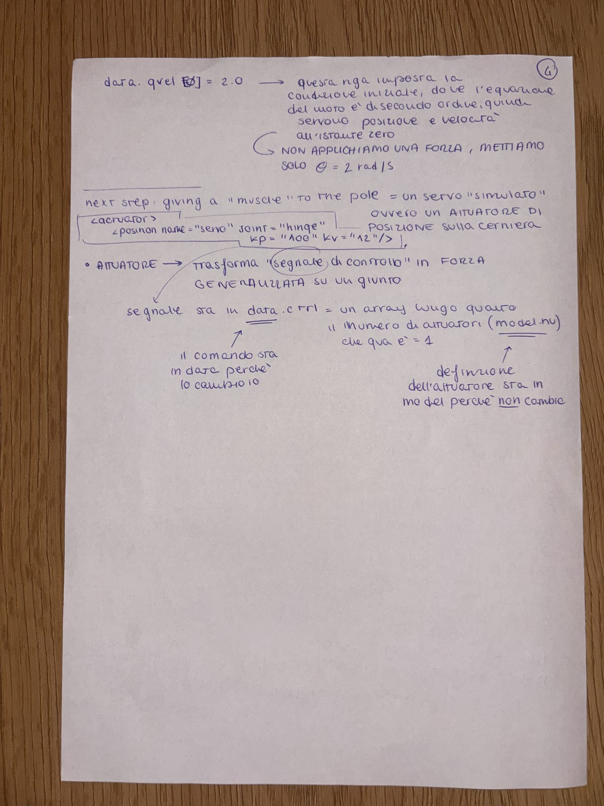

# 01 · MuJoCo foundations

**Date:** 2026-11-10 · **Notebook:** [`notebooks/01-mujoco-foundations.ipynb`](../notebooks/01-mujoco-foundations.ipynb) · **Log:** [2026-11-10](../log/2026-11-10-mujoco-part-1.md)

## Goal of the lesson

Go from "what is a physics simulator" to a pole that holds itself at a commanded angle with a simulated servo, and understand every number MuJoCo hands back along the way. Then map the same ideas onto Sesame, the quadruped I'm building.

## Why simulation first

Transcribed from [page 1 of my notes](../notes/2026-11-10-mujoco-notes-1-vlas-colab-mjcf.jpg). `[?]` marks words I'm not sure about.

> after 2024 → new **paradigm shift** is **robotics foundation models**
> ↳ large scale robotics data is now released often, and architectures are standardizing
>
> SCALABLE ARCHITECTURE FOR ROBOTICS = `[?]` **VLAs**
> - 1 part of the model takes care of perceiving the environment → **PERCEIVING**
> - 1 part of the model where you learn how to actually act → **ACTING**
>
> **PERCEIVING + ACTING**
>
> [GETTING STARTED WITH ~~ISAAC SIM~~] — my ass. `[?]` need GPU
>
> **MuJoCo on Google Colab** → vs LeRobot
> → motore fisico più affidabile, parte sempre (Python)
> *(more reliable physics engine, always starts)*


- **MJCF structure.** `<worldbody>` is the fixed world; every `<body>` inside it is a rigid body; a `<joint>` says *how* that body may move relative to its parent; a `<geom>` gives it shape, collision and (via density) mass. A body with no joint is welded to its parent.
- **`model` vs `data`.** `MjModel` is the static spec sheet of the robot: bodies, joints, masses, geometry. It never changes during a simulation. `MjData` is the state that evolves: positions, velocities, forces, time. Physics never edits the model, only the data.
- **Generalized vs maximal coordinates.** A free body in space needs 6 numbers (3 position + 3 orientation). A hinge imposes 5 constraints, leaving 1 DOF: the angle θ. MuJoCo stores only that minimal set (`qpos`, `qvel`), so joint limits come "for free". Maximal (Cartesian) coordinates store all 6 numbers per body and enforce the joints with extra equations and forces.
- **Kinematic chains.** Positions are always relative to the parent body; the chain starts at `worldbody` and ends at whatever hangs off the last link (the hand, the foot).
- **Forward vs inverse kinematics.** Forward: joint angles → where is the foot? (unique, easy). Inverse: I want the foot *here* → which joint angles? (may have zero, one or many solutions).
- **Equation of motion:** `M(q)·q̈ + c(q, q̇) = τ`
  - `M(q)` mass/inertia matrix (depends on the pose)
  - `c(q, q̇)` gravity + Coriolis/centrifugal terms
  - `τ` generalized forces we apply (motors, contacts)
- **Inverted pendulum.** Upright is an *unstable* equilibrium: any tiny push grows. One hinge means 1 DOF. How hard it is to rotate depends on the inertia tensor, which is mass *and* how far it sits from the axis.
- **Position actuator = PD controller.** `τ = kp·(ctrl − θ) − kv·θ̇`
  - `kp` stiffness: how hard it pulls toward the target
  - `kv` damping: brakes proportional to speed
  - too little `kv` gives oscillation, too much gives a sluggish response; **critical damping** is the fastest response with no overshoot
  - under gravity a pure PD never quite reaches the target: there's a **steady-state error** where `kp·error` balances the gravity torque
  - `forcerange` caps the torque, the way a real servo has a stall torque
- **Sesame's kinematic tree** (see the sketch below): free joint on the base + hip and foot joint per leg = 14 DOF, `nq = 15`.

## Key cells

### Setup *(not in the topic list; included because everything depends on it)*

```python
!pip install mujoco mediapy
```
- installs MuJoCo (the physics engine) and mediapy (shows videos inline). Colab ran MuJoCo **4.0.0**.

```python
import os
os.environ['MUJOCO_GL'] = 'egl'   # headless rendering, needed on Colab
import mujoco
import mediapy as media
import numpy as np
```
- `MUJOCO_GL='egl'` → on a laptop MuJoCo would open a window, but a Colab machine has no screen. EGL = render OpenGL **off-screen**, straight into memory.
- must be set **before** `import mujoco`.

### A pole on a hinge (passive, no motor)

```xml
<mujoco>
  <option gravity="0 0 -9.81"/>
  <worldbody>
    <light pos="0 0 3"/>
    <geom type="plane" size="2 2 0.1" rgba=".9 .9 .9 1"/>
    <body name="pole" pos="0 0 1">
      <joint name="hinge" type="hinge" axis="0 1 0"/>
      <geom type="capsule" fromto="0 0 0 0 0 -0.6" size="0.04" rgba="0 .6 .8 1"/>
    </body>
  </worldbody>
</mujoco>
```
- `gravity="0 0 -9.81"` → a vector: 9.81 m/s² pointing down the z axis.
- `<light pos="0 0 3"/>` → 3 m above the world origin.
- floor `geom` sits directly in `worldbody` → no joint → it's part of the fixed world.
- `body "pole"` at 1 m height; its position is relative to its parent (here: the world).
- `joint type="hinge" axis="0 1 0"` → rotates around y only. 1 DOF.
- capsule `fromto` → from the hinge 0.6 m **down** (hanging) with radius 4 cm. No mass given, so MuJoCo uses the density of water (1000 kg/m³).

```python
model = mujoco.MjModel.from_xml_string(xml)   # static: the spec sheet
data  = mujoco.MjData(model)                   # dynamic: the state
mujoco.mj_resetData(model, data)
data.qvel[0] = 0.01                            # small initial push
while data.time < 4:
    mujoco.mj_step(model, data)                # advance physics by one timestep
    if len(frames) < data.time * 30:           # grab a frame only at 30 fps
        ...
```
- `qvel[0] = 0.01` → only sets an initial condition. The equation of motion is 2nd order, so it needs a starting position *and* velocity. We're not applying a force.
- the `if` keeps the video at 30 fps even though physics steps much faster.

### Inspecting the state

```python
print(model.nq, model.nv, model.nbody)   # → 1 1 2
print(model.body_mass)                   # → [0. 3.28401152]
print(data.qpos[0] / (2 * np.pi))        # → 3.17
print(data.xpos[1], data.geom_xpos[1])   # → [0 0 1]  [0.261 0 1.147]
```
- `nq = nv = 1` → one hinge, one angle, one angular velocity. `nbody = 2` → the world counts as body 0.
- mass 3.284 kg = capsule volume (cylinder π·0.04²·0.6 + sphere 4/3·π·0.04³ = 0.003284 m³) × water density. A *very* heavy pole.
- `qpos[0] / 2π` → see the questions below.
- `xpos` = body origin (the hinge, fixed at z = 1); `geom_xpos` = centre of the capsule, 0.3 m away from it.

> ⚠️ **Note to self:** these outputs come from a run where the capsule pointed **up** (`fromto="0 0 0 0 0 0.6"`): the capsule centre is at z = 1.147, above the hinge. The code above it now has the pole hanging down. With the pole up and no motor, the inverted pendulum falls over and keeps spinning (no friction), which is why `qpos` reached ~3 turns.

### Giving the pole a "muscle": a position servo

```xml
<geom type="capsule" fromto="0 0 0 0 0 0.6" .../>   <!-- pole now points UP -->
...
<actuator>
  <position name="servo" joint="hinge" kp="100" kv="12"/>
</actuator>
```
```python
data.ctrl[0] = 0.5          # commanded angle: 0.5 rad ≈ 29°
t.append(data.time); theta.append(data.qpos[0])
```
- `<position>` = a simulated servo: turns a **control signal** into a generalized force on the joint, `τ = 100·(ctrl − θ) − 12·θ̇`.
- the actuator **definition** lives in `model` (it doesn't change); the **command** lives in `data.ctrl` (it changes over time). `data.ctrl` is an array of length `model.nu` = number of actuators = 1 here.
- the plot (in the original Colab run): θ rises in ~0.4 s with **no overshoot** and settles at **≈ 0.55 rad, not 0.5**.

Why 0.55? Steady state means θ̇ = 0, so the servo torque balances gravity:

```
kp·(0.5 − θ) + m·g·d·sin θ = 0        m·g·d = 3.284 · 9.81 · 0.3 ≈ 9.67 N·m
→ θ ≈ 0.551 rad   (steady-state error ≈ −0.05 rad ≈ −3°)
```
The pole is upright, so gravity pushes it *further* in the direction it's leaning, and the servo settles past the target. A bigger `kp` shrinks the error but never removes it. That needs an integral term or a feed-forward gravity term.

Why no overshoot? My back-of-envelope check, treating the capsule as a thin rod:
```
I ≈ m·L²/3 = 3.284 · 0.6² / 3 ≈ 0.39 kg·m²
effective stiffness k = kp − m·g·d·cos θ ≈ 100 − 8.2 ≈ 92 N·m/rad
damping ratio ζ = kv / (2·√(k·I)) ≈ 12 / (2·√(92·0.39)) ≈ 1.0
```
ζ ≈ 1 → `kv = 12` is almost exactly **critical damping**.

**`forcerange`, the real-world limit.** In the sim the servo can produce any torque. A real servo can't:
```xml
<position joint="hinge" kp="100" kv="12" forcelimited="true" forcerange="-0.2 0.2"/>
```
An MG90S is rated around 2 kg·cm ≈ 0.2 N·m (check the datasheet for the voltage used). This water-filled pole needs ~4.6 N·m just to hold 0.5 rad, more than 20× what an MG90S can give, so with `forcerange` it would simply fall. Sesame's legs are much lighter and shorter.

## Sesame's kinematic tree



```
world (fixed)
└── free joint (6 DOF, no motor)
    └── central body: ESP32, battery, OLED
        ├── hip (vertical axis) → femur → foot joint (horizontal axis) → foot   × 4 legs
```
- **DOF:** 6 (free joint) + 4 legs × 2 joints = **14** → `nv = 14`, and 8 actuated joints = 8 servos.
- **`nq = 15`, not 14:** the free joint stores orientation as a **quaternion** (4 numbers for 3 rotational DOF), so `qpos` has 3 + 4 + 8 = 15 entries while `qvel` has 14.
- the base has **no motor**: the robot can only move its body by pushing on the ground with its feet.

## Questions I asked myself

- **What does `qpos[0] / (2π)` measure?** The number of **full rotations completed** by the hinge (radians ÷ 2π). It is *not* seconds per turn. 3.17 = just over three turns in 4 s of free fall-and-spin.
- **What's the difference between sitting *in* `worldbody` and being a `<body>` inside it?** Floor and light sit directly in the world, so they're fixed. The pole is a body with a joint, so it moves relative to its parent.
- **Where does the mass come from if I never wrote one?** From the geom volume × default density (water).
- **Why does the command live in `data` but the actuator in `model`?** The servo's specs don't change during the run; what I ask it to do does.
- **Open:** what's the cleanest way to kill the steady-state error: higher `kp`, an integral term, or adding gravity compensation to `ctrl`?
- **Open:** how do I pick `kp`/`kv` for a real MG90S whose torque is capped by `forcerange`?

## Handwritten notes

| | |
|---|---|
|  |  |
| p.1: foundation models & VLAs, Colab + EGL, first MJCF | p.2: kinematic chain, model vs data |
|  |  |
| p.3: qpos/qvel, generalized coordinates, equation of motion | p.4: initial conditions, the position actuator |

## Next step

Make `ctrl` change over time, e.g. `data.ctrl[0] = A·sin(2π·f·t)`, and plot commanded vs measured angle. That's the first real control loop: the servo has to *track* a moving target, not just reach a fixed one.
