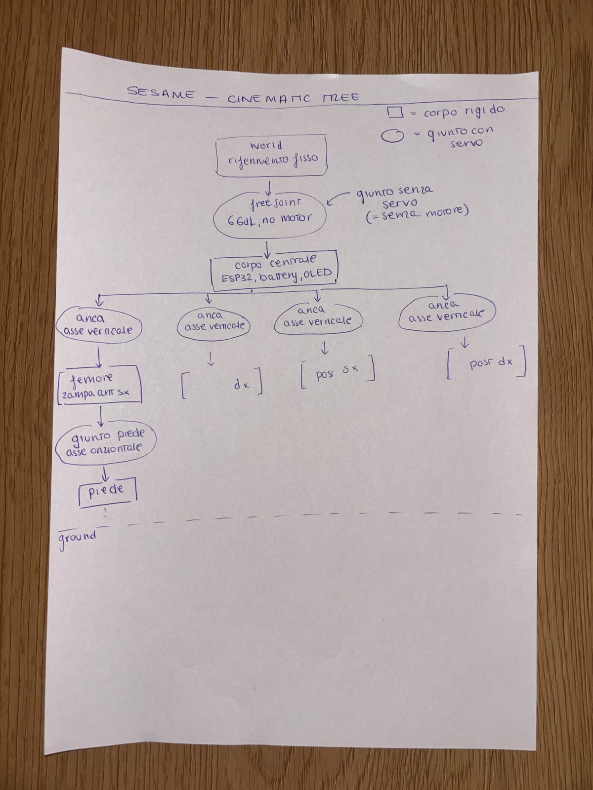

# 2026-11-10 · MuJoCo, part 1

**Tags:** course, sim

Did the first part of the MuJoCo course in Colab: from a pole hanging on a hinge to a pole held upright by a simulated servo. Then I drew Sesame's kinematic tree by hand to see the same ideas on my own robot.

Full lesson notes: [course/01 · MuJoCo foundations](../course/01-mujoco-foundations.md)

## What I learned

-

## Next

- Make `ctrl` follow a sine wave: first real control loop.
